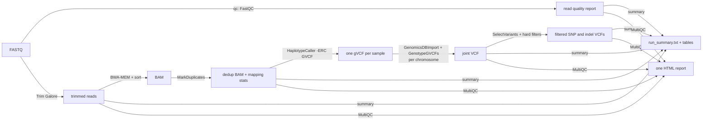

# GermCall

**From raw sequencing reads to a joint-called VCF: read QC, trimming, mapping and GATK variant calling for germplasm collections.**

GermCall is the first half of a two-part workflow. Its final VCF is the input of **GermGWAS** (its sister repository) (population structure, diversity, GWAS, core collection). It is not tied to a species: it works for any diploid or polyploid plant (or other organism) with a reference genome and a panel of re-sequenced accessions (see [Adapting to your species](#adapting-to-your-species)).



> **New to these steps?** [docs/STEP_GUIDE.md](docs/STEP_GUIDE.md) explains what every stage does and how to read its results.

## Contents
1. [Install](#install)
2. [Quick start](#quick-start)
3. [Inputs](#inputs)
4. [Stages and outputs](#stages-and-outputs)
5. [Configuration](#configuration)
6. [Adapting to your species](#adapting-to-your-species)
7. [Resources](#resources)
8. [Using the result in GermGWAS](#using-the-result-in-germgwas)
9. [What has been tested](#what-has-been-tested)
10. [Troubleshooting](#troubleshooting)

## Install
```bash
git clone https://github.com/miyak1/GermCall.git && cd GermCall
conda config --set channel_priority strict
conda env create -f environment.yml          # FastQC, MultiQC, Trim Galore, BWA, samtools, bcftools, GATK4, Java 17
conda activate germcall
gatk --version; bwa 2>&1 | head -3; trim_galore --version | head -3; fastqc --version; multiqc --version
```
Details and alternatives: [docs/INSTALLATION.md](docs/INSTALLATION.md).

## Quick start
```bash
conda activate germcall
cp config/config.example.yaml config/my_config.yaml     # set reference, samples table, workdir, threads, n_chromosomes, ploidy
cp config/samples.example.tsv config/samples.tsv        # one line per sample: name <TAB> R1 <TAB> R2

bash germcall.sh --config config/my_config.yaml                 # prepare, qc, trim_align, gvcf, joint
bash germcall.sh --config config/my_config.yaml --steps filter,summary,report
bash germcall.sh --config config/my_config.yaml --all           # everything in one go
```
**Try 2-3 samples first.** Put only those in the sample table, run everything, and look at the report before you start the real, long run. Run long jobs in `tmux` or with `nohup`.

A small simulated data set tests your installation (a few minutes): `bash examples/run_test.sh`.

## Inputs
1. **Reference genome** (FASTA). Use the same file for every stage. Indices are created next to it, so the folder must be writable.
2. **Sample table** (tab-separated): the first column is the sample name that ends up in the VCF, so write the ID you use for the sample everywhere else (e.g. `ACC001`; letters, digits `. _ -` only). Then R1 and R2 (R2 is ignored for single-end data, `calling.paired: false`).
   ```
   # sample    R1                           R2
   ACC001      /data/fastq/ACC001_R1.fastq.gz  /data/fastq/ACC001_R2.fastq.gz
   ```
   Lines starting with `#` are ignored. If a sample was sequenced in several lanes, concatenate its lane files first (`cat lane1_R1.fq.gz lane2_R1.fq.gz > ACC001_R1.fastq.gz`).

## Stages and outputs
| Stage | What it does | Main output |
|---|---|---|
| `prepare` | checks tools, sample table and files; indexes the reference (BWA, `.fai`, `.dict`) | indices next to the reference |
| `qc` | **FastQC** on the raw reads of every sample | `00_fastqc_raw/<sample>/*_fastqc.html` |
| `trim_align` | **Trim Galore** (adapters, low-quality ends) → FastQC on trimmed reads → **BWA-MEM** with a read group `SM:<sample>` → sort → **MarkDuplicates** → statistics | `02_bam/<sample>.dedup.bam`, `02_bam/bam_summary.tsv` |
| `gvcf` | **GATK HaplotypeCaller `-ERC GVCF`**: a record for every position, per sample | `03_gvcf/<sample>.g.vcf.gz` |
| `joint` | combine all gVCFs (`GenomicsDBImport`, or `CombineGVCFs`) and **GenotypeGVCFs**, one job per chromosome, then concatenate | `04_joint/<prefix>_joint_raw.vcf.gz` |
| `filter` | split SNPs / indels and apply GATK's generic hard filters to each | `05_filtered/<prefix>_snps_pass.vcf.gz`, `<prefix>_indels_pass.vcf.gz` |
| `summary` | one report: reference, raw reads, trimming, mapping, SNP / indel counts, filter criteria and what each filter removed, per-sample genotype statistics | `summary/run_summary.txt` and `summary/*.tsv` |
| `report` | **MultiQC**: one page with read quality, trimming, mapping, duplicates and variant statistics | `qc_reports/multiqc_report.html` |

Finished pieces are remembered in `<workdir>/status/`, so the same command resumes after an interruption. Delete a sample's file there to redo it. Logs per sample / chromosome are in `<workdir>/logs/`.

**Look at `02_bam/bam_summary.tsv` before starting `gvcf`.** It lists reads, mapping %, duplicate % and mean depth per sample; fix or drop samples with a very low mapping rate or depth first.

## Configuration
Everything is in one YAML file; see the commented [`config/config.example.yaml`](config/config.example.yaml).

| Key | Meaning |
|---|---|
| `project.workdir`, `project.prefix`, `project.threads` | output folder, file prefix, total CPU threads |
| `calling.reference`, `calling.samples_file`, `calling.paired` | inputs |
| `calling.parallel_samples`, `threads_per_sample`, `parallel_intervals`, `java_mem_gb` | parallelism and memory |
| `calling.trim_quality`, `trim_min_length`, `trim_extra`, `fastqc_after_trim` | trimming |
| `calling.combine_method` | `genomicsdb` (default) or `combinegvcfs` |
| `calling.n_chromosomes` (or `chromosomes`), `include_unplaced` | **number of chromosomes of your species** (required) and which contigs are genotyped as separate jobs |
| `calling.ploidy` | 2 for diploids; 4, 6 ... for polyploids |
| `calling.filter_*`, `calling.filter_indel_*` | hard-filter thresholds for SNPs (QD, QUAL, SOR, FS, MQ, MQRankSum, ReadPosRankSum) and indels (QD, QUAL, FS, ReadPosRankSum) |
| `calling.keep_trimmed_fastq`, `keep_unmarked_bam`, `keep_genomicsdb` | keep or delete large intermediate files |
| `tools.*` | executable names or full paths |

## Adapting to your species
Nothing in GermCall is specific to one crop. For a new species, check these settings in your config:
- **`calling.reference`**: the genome FASTA of your species (any assembly: chromosome-level or scaffold-level).
- **`calling.n_chromosomes`**: the haploid chromosome number (the *N* longest contigs are treated as the chromosomes and genotyped as separate jobs). If your assembly names the chromosomes in a different way, list them in `calling.chromosomes` instead.
- **`calling.include_unplaced`**: `true` also genotypes the remaining contigs (one small job each). For a very fragmented assembly (thousands of scaffolds) set `false`, or the number of jobs becomes very large.
- **`calling.ploidy`**: `2` for diploids; use the real ploidy for polyploids (e.g. `4` tetraploid potato, `6` bread wheat). GATK then reports genotypes with that many alleles. Be aware that many downstream population-genetic tools, including parts of GermGWAS, assume diploid genotypes, so polyploid data may need extra care or a diploidised representation.
- **Genome size** decides the run time and memory: large genomes (several Gb) need much more time per sample, more `java_mem_gb`, and more disk space.
- **Library type**: for single-end data set `calling.paired: false`; for libraries with special adapters pass options to Trim Galore with `calling.trim_extra`.
- **Hard filters**: the thresholds are GATK's generic recommendations. Check the distributions for your data (see `docs/STEP_GUIDE.md`) before relying on them; they can be changed in the config.

## Resources
- `parallel_samples × threads_per_sample` should not exceed your CPU threads; `parallel_samples × java_mem_gb` (and `parallel_intervals × java_mem_gb`) must fit in RAM.
- HaplotypeCaller is the slowest stage (hours per sample for a genome of a few hundred Mb at ordinary depth).
- Disk space: BAMs and gVCFs are large. By default the trimmed FASTQ, the unmarked BAM and the GenomicsDB workspaces are deleted when no longer needed.

## Using the result in GermGWAS
In the GermGWAS config:
```yaml
input:
  merged_vcf: /path/to/05_filtered/<prefix>_snps_pass.vcf.gz     # skip GermGWAS' 'merge' step
```
The joint VCF carries `FORMAT/DP` and `GQ`, so GermGWAS' default QC filters (`qc.min_dp: 3`, `qc.min_gq: 10`) work. Its input check also compares the sample names with your phenotype file.

## What has been tested
- **Real data:** a 108-sample paired-end diploid panel (genome about 230 Mb, 7 chromosomes + 81 unplaced scaffolds). The stages `prepare`, `qc`, `trim_align`, `gvcf`, `joint`, `filter` and `summary` ran to completion with GATK 4.6, BWA 0.7.19 and Trim Galore; a rerun correctly skipped all finished work.
- **Not yet used on real data:** the `report` stage (MultiQC) and single-end mode were tested only on small simulated data; `combine_method: combinegvcfs` and `calling.ploidy` other than 2 have not been used on real data. Please report any problem.
- A small simulated data set tests your installation (a few minutes): `bash examples/run_test.sh`.

## Troubleshooting
| Problem | Fix |
|---|---|
| `ERROR: R2 file not found` | check the sample table; set `calling.paired: false` for single-end data |
| Trim Galore: `Cutadapt` not found | `conda install -c bioconda cutadapt` |
| `java` / GATK memory errors (`OutOfMemory`) | raise `calling.java_mem_gb` or lower `parallel_samples` / `parallel_intervals` |
| GenomicsDBImport fails for a contig | read `logs/joint_<contig>.log`; as a fallback set `calling.combine_method: combinegvcfs` |
| Mapping rate very low for one sample | wrong reference, contamination or a sample mix-up: check its FastQC and the first reads with BLAST before continuing |
| Joint VCF has fewer samples than the table | a gVCF stage failed or a sample name is duplicated; check `logs/` and `status/` |
